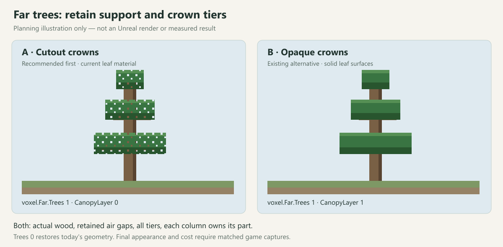

# Far trees: item 1 plan

2026-10-13. **Approved by Jesus: "Let's do it!" Implemented; final checks green. Jesus reviewed the images and requested a stop/documentation handoff for another chat to commit/push.** Report directly to Jesus (the Claude manager instruction was withdrawn). See the [completed implementation record](2026-10-13-Far-Trees.md) and [release handoff](2026-10-13-Far-Trees-Handoff.md).

At plan approval, `feature/voxel-lod3` was clean at `a09cb14` and fast-forwarded to local `feature/voxel-world`, `8ff64c7`, as requested. Pre-merge refs/status/index are preserved under `Saved/LOD3Planning/2026-10-13/`. The later implementation and validation are recorded in [Far trees](2026-10-13-Far-Trees.md).

## Proposal

Keep actual trunks/branches and every crown tier as compact vertical runs from final voxel cells. Merge compatible exposed faces. Each column emits only its own cells, so a tree crossing a border keeps the same footprint and cannot be recreated twice. Keep real air gaps; never invent a trunk beneath every leaf cell.

The current mesher skips logs/stems (`VoxelFarMesher.cpp:117-140`) and stores only the first leaf run (`:163-209`). Final columns have no retained tree identities. This approach therefore needs no generation changes, tree registry, summary cache or edit-version policy beyond the existing immutable column/edit path. It takes the complete-silhouette objective from [Veloren's LOD objects](https://veloren.net/blog/devblog-171/), whose published implementation uses pre-generated tree positions/kinds and cheap placeholders; this proposal derives geometry from our final cells instead.

## Switch and files

- `voxel.Far.Trees 0`: today's exact summary/mesh path. Initial default remains 0 during evaluation.
- `voxel.Far.Trees 1`: trunk/branch runs plus all exposed crown tiers. Enabling it by default is a look decision after captures and costs.
- `Source/UnnamedVoxel/Meshing/VoxelFarMesher.h/.cpp`: optional run storage, classification and face emission. Preserve state/axis, tints, snow tops and air gaps. No small fixed tier cap: the existing `FWallRun Pending[8]` cannot simply be reused for arbitrary multi-tier subtraction.
- `Source/Unnamed/Voxel/VoxelConsole.h/.cpp`, `VoxelWorldSubsystem.cpp`, `VoxelColumnPipeline.h/.cpp`: switch wiring, worker option snapshot, invalidation and obsolete-option result rejection. Purge stale queued far results using the repaired A1 invariant; retain displayed geometry until replacement. Do not change ordinary edit-stale acceptance or scheduling policy.
- `Source/Unnamed/Tests/VoxelFarMesherTests.cpp`, `VoxelPipelineFarRingTests.cpp`; update `Docs/VoxelWorld.md` and the item record after implementation.

Use the existing far materials and `MPC_VoxelLook`. The existing `voxel.Far.CanopyLayer` offers cutout (0) or opaque (1) leaves. No material regeneration is proposed for item 1. Neighbor full-summary optimization stays in item 3.

## Pictures and look options

The two real review frames below share a pose but differ in render distance; they are **existing evidence and a near-tree reference, not a new before/after result**. Both were visually inspected and are populated.

- [Current RD4: missing support under the upper-right crown](C:/dev/sandbox/lod-review/screenshots/01-floating-crowns-rd4.png)
- [RD12 reference: trunk and complete tree at the same pose](C:/dev/sandbox/lod-review/screenshots/02-tree-support-rd12-control.png)

**A, recommended first:** trunks and full tiers using today's cutout leaves. **B:** the same geometry with opaque crowns, using the existing switch. These drawings explain the choice; only actual Unreal captures can establish the look and cost. This does not decide item 2's edge-fade/AA work.

After go, capture Trees 0 and 1 at the exact review pose through `TestFoundationRuntime.ps1 -Editor -Suite views -FullCostRendering -FrameRates 60 -Width 1600 -Height 900`, using `-ExecCmds 'voxel.Far.Trees 0'` / `1` and fresh `-OutputDirectory` folders. The suite sets RD4/8 and RD12/24 itself; do not override its radii. Pose source: `Scripts/Views/DevSeed.txt`, `day-open -31 -29 63 135 -5`, noon. Add tiered trees, a four-column tree and a close near/far handoff using capture arguments or pose data, never a new C++ capture scenario. Reject black/empty controls. Preserve seed, pose, clock, exposure, resolution and AA across each pair.

## Acceptance

1. Independent expected-face fixtures: bare trunk, ordinary crown, separated tiers, horizontal branch, adjacent state/tint changes, snow, and more than eight runs. Require zero missing or duplicate expected external faces, no invented connecting wood, correct layer/state and deterministic output. Explicitly allow and count opposing hidden border caps described below; those are not duplicate tree instances.
2. Repeat fixtures across all four edges, a four-column corner and negative coordinates; compare translated world-space coverage. Exercise far/far, near/far, cold arrival, border edits and mixed old/new tree modes. Cutout leaves must not incorrectly hide wood visible through their mask. Wanted-near state alone is not proof of displayed coverage.
3. Toggle 0 -> 1 -> 0 with jobs queued/in flight and reversed completion order. No obsolete-option result may install after the switch; existing visible coverage stays while replacements converge. Restored mode must recover legacy output.
4. Mutations must fail for omitted trunks, discarded lower tiers, wrong border mapping, run truncation and disabled option-result invalidation. Restore changes exactly and rebuild before final verification.
5. Keep the legacy far digest `0x21cb3f5108dbe83b` at Trees 0. **Stop and report if `Mesher.Digest` or radius-8 world hashes move; never re-record goldens.** No generator or full-mesher changes are planned.
6. Beside matched screenshots report far quads and stream bytes, summary+mesh time, apply time/peak and near/far/coarse hole counters. Extra tree geometry has a cost; no throughput claim follows from a loaded-machine run. Request Jesus's quiet window before timed A/Bs. The historical A/B still belongs to item 4, with trees disabled for the correctness comparison.
7. Independent diff review, focused automation and mutations, then `RunChecks.ps1 -Profile final -Flight smoke` on final restored binaries. Call `Scripts/QuietWindow.ps1 -Name <what>` before each heavy launch; use `-NoHotReloadFromIDE`, plus `-DisableAdaptiveUnity` after restores/reverts. Kill only owned processes.

Report the result and remaining gaps to Jesus, then wait for local commit approval. Never push. Item 2 gets its own plan and go after item 1 is accepted.

## Limits to keep explicit

During asynchronous tree-mode changes, a neighbor may still display legacy geometry. Do not cull new wood or lower-tier boundary faces against vegetation that the legacy neighbor omits. Keep conservative border caps, merge/cull inside each column, and count the extra hidden faces when both columns show the new mode. This closes each new tree portion without adding a tile-style coordinated apply system. The switch converges per column; it is not an atomic whole-forest swap, so the old half can remain incomplete until its replacement arrives. Test both mixed-mode directions explicitly.

Surface summaries still flatten arbitrary roofs/terrain; retaining vegetation runs does not provide general far caves or all mushroom/root/material parity. Include relevant natural-tree fixtures before claiming complete tree coverage. If preserving those silhouettes needs a wider representation, report that scope before expanding it.

The correctness records say 3,168 -> 4,479 far-hole frames, while this task brief says 3,168 -> 5,478; the independent review records 4,509/6,000 at seed 42, RD12/24. These are different recorded figures, not a resolved performance comparison. Reconcile exact run artifacts before item 4.
